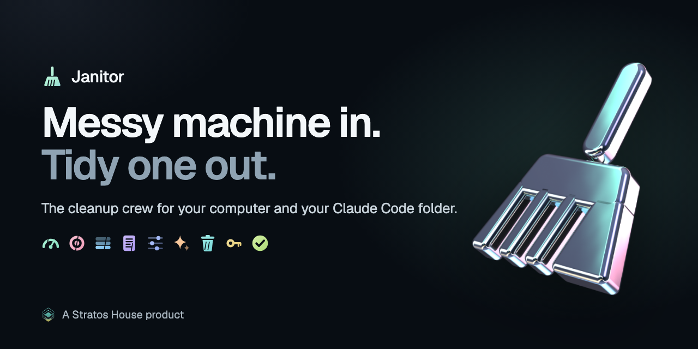
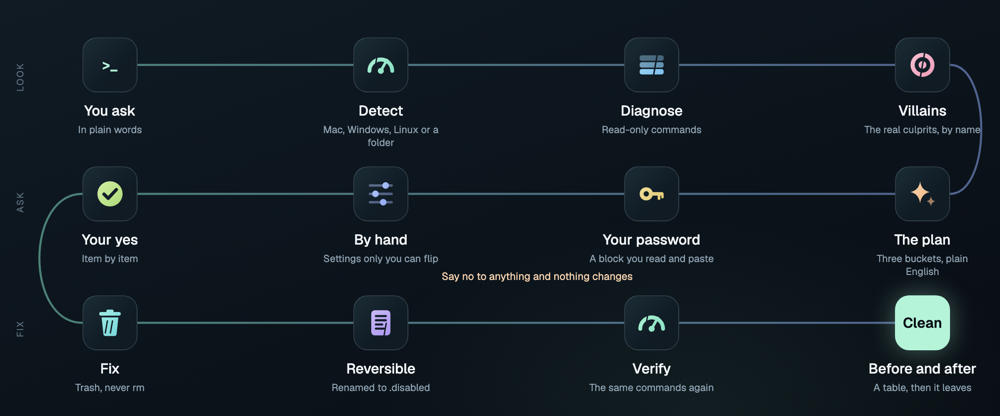

<div align="center">
  <a href="https://github.com/ArshiaEcho/janitor"></a>

  <h1>Janitor</h1>

  <p><strong>The cleanup crew for your computer and your Claude Code folder.</strong><br>
  A Claude Code plugin that finds what is slowing your machine down or cluttering your project, tells you in plain English, asks first, then fixes it. Everything it touches can be undone.</p>

  <p>
    <a href="#install"></a>
    <a href="#what-it-does"></a>
    <a href="#what-it-never-does"></a>
    <a href="LICENSE"></a>
    <a href="https://www.stratosagency.ai"></a>
  </p>
</div>

<div align="center"></div>

<p align="center"><sub>The folder is a demo with planted clutter. Every finding is one the skill made on it in a real run.</sub></p>

> **Machine feeling slow?** Just say so. Janitor works from plain words, so there is nothing to remember:
>
> ```text
> my mac is slow
> ```
>
> Or tidy the project you are in with `clean up this folder`, or call either skill by name with `/janitor-device` and `/janitor-claude`.

## What it does

You describe the problem. Janitor gives Claude the catalogs, commands and rules to find the real cause and fix it safely.

- **Slow machines.** It reads CPU, memory, disk, battery and heat, then names the 3 to 5 processes actually to blame, with their real numbers.
- **macOS, Windows and Linux.** It detects the system and loads only the catalog for it: macOS 26 and 27, Windows 11 25H2 and 26H2, and GNOME or KDE desktops on Linux, including WSL. Linux is new in 0.3.
- **Disk hogs for developers.** Xcode build data and old simulators, Homebrew, npm, pnpm, yarn, uv and pip caches, and local AI model folders, with sizes shown before anything moves.
- **Claude Code folders.** Caches, dead symlinks, stray scratch files, oversized files in Claude's read path and broken wiki links in a vault.
- **Claude Code config.** Instruction files that overlap or run long, `@imports` that point nowhere, hooks and MCP servers whose commands are missing, skills with broken frontmatter, settings drift and stale worktrees.
- **Secrets in the open.** Tracked `.env` files and likely keys, reported as `file:line` only. The value is never printed.
- **A plan in three buckets.** What it can fix, what needs your password as a block you read and paste, and what only you can switch.
- **A before and after.** It runs the same commands again and shows you the difference.

## Install

In Claude Code:

```text
/plugin marketplace add ArshiaEcho/janitor
/plugin install janitor@janitor
```

Or from a terminal:

```bash
claude plugin marketplace add ArshiaEcho/janitor
claude plugin install janitor@janitor
```

Then quit Claude Code fully and open it again. Skills load when a session starts, so `/clear` is not enough. That one step is behind almost every "it does not show up" report.

**Check it took:** `claude plugin list` should show `janitor@janitor`.

**To hack on it,** clone the repo, then run `claude plugin marketplace add ./janitor` and install as above. Your edits apply on the next restart.

## Use it

Ask in your own words:

```text
my mac is slow
my pc fans won't stop
why is my laptop battery dying in two hours
clean up this folder
audit my CLAUDE.md
```

Both skills run the same five steps: diagnose, name the villains, show the plan and ask, fix what you approved, verify.

- **Nothing happens without a yes.** Cache clean-ups take one yes for the batch. Everything else is item by item.
- **Your password stays yours.** Anything that needs `sudo` or admin is shown as plain text for you to run. Janitor never runs it.
- **Your home folder is opt in.** `janitor-claude` only looks at `~/.claude` when you ask it to, and then reports sizes, never transcript contents.

## The tools

<table>
  <tr>
    <td width="33%"><br><strong>Diagnose</strong><br>Read-only commands for CPU, memory, load, heat, disk, battery and startup items. Nothing changes while it looks.</td>
    <td width="33%"><br><strong>Villains</strong><br>Catalogs of the real culprits on macOS, Windows and Linux, ranked by how often they are to blame, each dated so stale entries show.</td>
    <td width="33%"><br><strong>Disk</strong><br>Developer caches, build data, old simulators and local model folders, sized first. Models never move without a yes for each one.</td>
  </tr>
  <tr>
    <td><br><strong>Memory files</strong><br>CLAUDE.md, CLAUDE.local.md, AGENTS.md and rules checked for overlap, length and imports that point nowhere. Edits are shown as a diff first.</td>
    <td><br><strong>Config</strong><br>Hooks, MCP servers, skills, agents and commands whose files are missing or malformed, and allow rules that pile up.</td>
    <td><br><strong>Clutter</strong><br>.DS_Store, bytecode, tool caches, dead symlinks, scratch files, tracked build output and broken wiki links.</td>
  </tr>
  <tr>
    <td><br><strong>Trash, never rm</strong><br>Files go to the Trash or Recycle Bin. Startup items are renamed to <code>.disabled</code>. Everything comes back.</td>
    <td><br><strong>Your password</strong><br>Admin steps arrive as a plain block you read and paste yourself. No base64, no <code>curl | bash</code>.</td>
    <td><br><strong>Verify</strong><br>The same commands run again, and a before and after table shows what changed.</td>
  </tr>
</table>

## How it works

<div align="center"></div>

Janitor is two skills and their reference files. `SKILL.md` holds the steps and the safety rules and loads on every run. The catalogs, fix blocks and audit patterns sit in `references/` and load only when needed, so a Windows machine never reads the macOS catalog. There is no app, no daemon and no binary. Claude runs ordinary shell commands you can read, and the skill tells it which ones.

## What it never does

Every line here is a rule in the skill itself, read on every run.

- **No network.** No telemetry, no version checks, no analytics, no auto-updates. If you see it reach for the network, that is a bug.
- **No deleting.** Trash and Recycle Bin only, through the system's own mechanisms. Never `rm`. Where only a tool's own clean command can free the space, such as `brew cleanup`, `xcrun simctl runtime delete` or `ollama rm`, it is handed to you as a block to run yourself.
- **No silent sudo.** Anything elevated is a plain block for you to run.
- **No git changes.** It reads `status`, `log`, `diff` and `worktree list`. It never commits, removes, resets, prunes or cleans.
- **No silent edits to your instructions.** CLAUDE.md changes are shown as a diff first. Broken wiki links are reported, never rewritten.
- **No reading your transcripts.** Session history under `~/.claude/projects` is sized, never opened.
- **No printing secrets.** Likely keys are reported as `file:line`. If one is already in git history, it tells you to rotate it.
- **No weakening your machine.** No SIP, Gatekeeper, Defender or boot changes, no kernel extensions, no renames of your files.

## What it costs

Janitor is free and MIT licensed. It runs inside your Claude Code session, so its only cost is the tokens that session uses. It has no paid tier and no account.

## Honest limits

- **The catalogs age.** Each one carries a "Last verified" date, now November 2026. A villain that mattered then may be fixed later, and a new one will take its place.
- **It reads the machine, not the hardware.** A failing SSD, dust in the vents or a firmware bug will show as symptoms with no named villain. It says so when diagnostics come back clean.
- **Managed work laptops push back.** IT-managed startup items may refuse to disable or raise alerts. Skip what you do not recognise.
- **Large vaults are slow.** The broken-link audit walks every file once. Five thousand notes can take 30 seconds or more.
- **Secret detection is a short, precise list.** It is not a substitute for `gitleaks`.
- **Out of scope on purpose:** GPU and game stutter, servers over SSH, Docker images and volumes, slow builds, slow internet and code quality.
- **Windows PowerShell 5.1 sees less.** PowerShell 7 or later gives the full read.

## Not proven yet

- **Linux is new.** The catalog follows current GNOME, KDE, snap and Flatpak docs and bug trackers. No command in it has run on a real Linux machine yet.
- **Windows changes have not run on Windows.** Some process names, such as the Widgets and Cross Device services, come from reports rather than Microsoft docs.
- **Snap commands are from memory.** The official snapd docs needed a sign-in, so `snap refresh --hold` and the retain range are unconfirmed.
- **A few macOS fixes rest on one source.** The `dasd` repair and the Spotlight loop are labelled as such in the catalog.
- **Tested on one Mac, read-only.** Both skills were run headless on macOS against this branch: `janitor-claude` on the demo folder above, `janitor-device` on a real Mac with a nearly full disk. Both found the planted or real problems, kept git and tool cleanups for the user, and stopped for a yes. The fix step was not run.
- **The new Claude Code checks are read from the docs.** They follow code.claude.com and the Claude Code changelog as of November 2026.
- **Developer cache sizes are reported, not benchmarked.** Each tool's own clean command is offered where one exists. What each saves depends on your machine.

Report what you find. A new villain with a detection command, a reversible fix, the OS version and the CPU or memory it burned is the fastest path to a merged PR.

## Contributing

Issues and PRs are welcome, within the rules: no network, no deleting, no silent sudo, no git changes, no obfuscation, and no disabling Windows Defender.

The README images are made in code. `scripts/brand/` holds the logo generator, the Blender script for the chrome broom, the banner and flow diagram pages and the terminal GIF, all in the Altocue house style. `scripts/brand/build_assets.sh` rebuilds them.

## Licence

Janitor is [MIT](LICENSE). The Geist fonts in `scripts/brand/fonts` are under the SIL Open Font License.

<div align="center"><br><a href="https://www.stratosagency.ai"></a><br><sub>A Stratos House product</sub></div>
